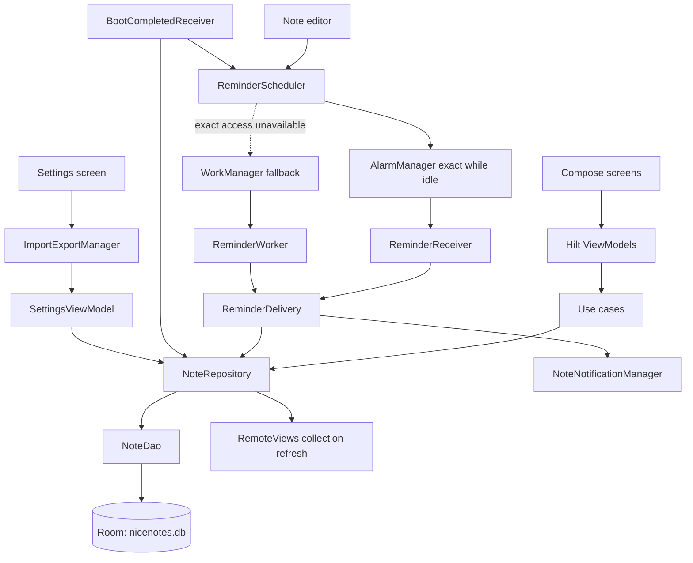

# NiceNotes Project Blueprint

## 1. Purpose and status

NiceNotes is a local-first Android notes app. The intended product combines quick text capture with organization, reminders, home-screen access, and backup/restore.

This blueprint documents the current repository as implemented and compares it with [`nice_notes_implementation_plan.md`](./nice_notes_implementation_plan.md). The source contains most planned architectural areas, but some user-facing requirements remain partial or defective. Do not interpret a listed component as proof that its entire planned behavior is complete.

## 2. Product scope

### Implemented surfaces

- Active-note list with text search.
- Note editor with pin, important, and reminder controls.
- Long-press management mode with drag reordering and hard delete.
- Swipe-to-archive on the active list.
- Archive list with swipe-to-unarchive.
- Settings screen with theme label and data import/export actions.
- Exact AlarmManager reminders with a WorkManager fallback, notifications, repeat scheduling, and boot-time re-scheduling.
- Scrollable native RemoteViews widget showing all active notes with one-line ellipsized previews; its add control sends a dedicated receiver action to open the note editor for a new note, including when the app is running.
- Legacy JSON-array import and versioned NiceNotes JSON serialization.

### Planned scope not fully delivered

- Complete archive management and consistent undo behavior.
- Reliable export of the full database and robust import validation/error reporting.
- Reliable per-note deep links.
- Exact recurrence rules, complete reminder lifecycle management, and reminder-state handling.
- DAO and Compose UI tests.
- Downloadable Inter font.

## 3. Technology and build configuration

| Concern | Current implementation |
|---|---|
| Language/UI | Kotlin, Jetpack Compose, Material 3 |
| Architecture | Compose screens/ViewModels → use cases → repository → Room DAO |
| Dependency injection | Hilt |
| Persistence | Room, one `notes` table, schema version 1 |
| Background work | AlarmManager exact reminders with WorkManager/Hilt fallback |
| Notifications | Android notification channel and notification intents |
| Widget | Android AppWidget `RemoteViews` collection |
| JSON | kotlinx.serialization |
| Reordering | `sh.calvin.reorderable` |
| Android SDK | min 36, compile 36, target 36 |
| Project modules | `:app` only |

The SDK configuration now matches the implementation plan with min SDK 36.

## 4. High-level architecture



### Runtime entry points

- `NiceNotesApp` enables Hilt and configures WorkManager with `HiltWorkerFactory`; it creates the reminder notification channel at application startup.
- `MainActivity` hosts the Navigation Compose graph for Main, Archive, and Settings.
- `BootCompletedReceiver` re-schedules active reminders after device boot, app updates, and exact-alarm access grants.
- `ReminderReceiver` delivers exact alarms; WorkManager runs the best-effort fallback when exact-alarm access is unavailable.
- `NotesWidgetReceiver` supplies the native widget layout; `NotesWidgetService` provides its Room-backed list rows, and the receiver exposes a repository-triggered collection refresh helper.
- `FileProvider` shares a cached JSON backup from Settings.

### Data ownership and flows

- The Room database is the persistent source of truth.
- `NoteDao` exposes active and archived note flows; active rows are ordered pinned-first and then by descending `position`.
- `NoteRepository` delegates persistence, supports reminder lookups, and triggers widget refreshes after several writes.
- Use cases expose discrete note actions to ViewModels. The domain currently uses `NoteEntity` directly rather than separate domain models.
- Screens collect ViewModel state and invoke user actions; the Main screen and Archive screen each handle snackbar events.

## 5. Data model

`NoteEntity` is stored in the `notes` table and keyed by `mLocalId`.

| Field group | Fields and purpose |
|---|---|
| Identity/content | `mLocalId`, optional `mGlobalId`, `mContent`, `mParentId` |
| Legacy compatibility | `mStatus`, `mTimestamp`, `mIsDelete`, `mIsLocal`, `mColorIndex`, `mSysVersion`, reminder pre-state, flattened `mExtra` values |
| Timestamps | Create/update/finish and alarm values stored as epoch milliseconds (`Long`/nullable `Long`) |
| Reminder state | `mAlarmTime`, `mAlarmTimePre`, `mNextAlarmTime`, `mRepeatRulePre`, `mForceReminderPre`, `isReminded` |
| NiceNotes organization | `isPinned`, `isImportant`, `isArchived`, `position` |

Legacy import maps `mIsDelete` to `isArchived`. Export maps entity timestamps back to the legacy formatted timestamp fields while retaining NiceNotes-only fields in the versioned format.

### Backup formats

- **Legacy input:** a bare JSON array of legacy note records.
- **NiceNotes format:** a JSON object containing `version`, `exportedAt`, and `notes`.
- The serializer ignores unknown JSON keys, allowing unknown fields to be ignored during decoding.
- Import uses `mLocalId` as the identity and `REPLACE` upsert semantics for collisions.

Current parsing checks are not equivalent to the planned validation: the version is not checked, required content is not validated, and broad parsing failures are converted to an empty result with zero skipped records.

## 6. Feature behavior and implementation audit

| Plan area | Implemented behavior | Remaining gap or deviation |
|---|---|---|
| Setup/dependencies | Compose, Room, Hilt, Navigation, WorkManager, Android RemoteViews, serialization, reorderable dependencies are configured. | Legacy storage permissions removed. |
| Theme | Always-dark palette and Material 3 theme are implemented. | Inter downloadable font is absent. |
| CRUD/list/search | Room-backed create/edit, blank-note guard, search flow, pin and important controls. | No dedicated DAO tests. |
| Archive | Main-list swipe archives and Archive screen swipe unarchives. | Archive management mode is absent. Archive screen delete is irreversible in the UI and its unarchive undo callback removes the note from Room. |
| Reordering | Management mode uses the reorderable Compose library and writes updated positions. | No UI test covers reorder behavior. |
| Reminders | Dialog chooses a future date/time and daily/weekly/monthly recurrence; the editor requests Android notification and exact-alarm access when needed. AlarmManager exact-while-idle alarms deliver through a receiver; WorkManager is a warned best-effort fallback. Boot and exact-access-grant broadcasts re-schedule reminders. Notification-channel sound is configured by default and disabled app/channel states link to system settings. | Sound still follows user channel settings, Do Not Disturb, and device volume. Archive does not cancel work. Monthly cadence is approximated as 30 days. The notification-to-editor deep link only resolves against active notes, so archived notes are not found by this lookup path. |
| Snackbar/undo | Main list archive and delete expose undo actions. | Archive deletion has no undo; Archive unarchive undo is incorrect. |
| Animations | Note enter visibility, important border color, content-size and Material sheet/swipe transitions are present. | No UI tests verify motion or accessibility behavior. |
| Widget | A native RemoteViews `ListView` collection reads and scrolls through all active notes in DAO order, displays one-line ellipsized previews, and refreshes after repository mutations. Each row passes its note ID to the app, and the add-note control sends a dedicated receiver action to open the editor for a new note, including when the app is running. Click bindings refresh after app updates and activity launches. Room read failures propagate instead of being converted to an empty list. | — |
| Import/export | File chooser, import manager, legacy compatibility, JSON export, FileProvider share intent are present. | Export collection waits on a non-terminating Flow and only observes active notes. Parser errors can look like a zero-error import; import does not reschedule reminder jobs. |
| Testing | Import/export dataset & round-trip tests; daily/weekly/monthly simple interval parser tests. | No in-memory Room DAO tests or planned Compose UI tests. |

### Important concrete behavior gaps

1. **Export does not take a one-time snapshot.** `SettingsViewModel.exportData()` calls `collect` on `observeActiveNotes()`, which is a Room `Flow` that normally stays active. Its `return@collect` only returns from the current collection callback; it does not stop collection. The export function therefore does not reliably reach serialization/sharing. The queried source also excludes archived notes.
2. **Archive unarchive undo deletes the row.** `ArchiveViewModel.archiveBack()` calls `DeleteNoteUseCase` with a copied note, rather than persisting an archived copy.
3. **Reminder lifecycle is inconsistent.** Reminder alarms are scheduled/cancelled from the editor save path, but repository archive/delete operations do not cancel them. Exact timing requires Android exact-alarm access; without it, reminders use best-effort WorkManager scheduling. Repeating monthly intervals are fixed to 30 days. Notification permission and channel settings must allow alerts; the editor requests permission and provides system-settings actions when notification or sound settings block delivery.
4. **Notification deep-link lookup.** The main screen retries note lookup when the active-note list emits, rather than only when the requested ID changes.
5. **Import errors are not surfaced faithfully.** `importFromStream()` catches broad exceptions and returns `(emptyList(), 0)`, which the Settings UI can report as a zero-record import rather than a parse failure.

## 7. Tests and verification

Current test sources:

- `ImportExportTest` checks the included sample data counts and a subset round trip.
- `ReminderSchedulerTest` checks basic daily, weekly, monthly interval conversion and unknown rules.

The implementation plan additionally calls for DAO tests against in-memory Room and Compose UI tests for main-list, editor, archive, undo, search, and widget interactions. Those tests are not present in `app/src/test` or `app/src/androidTest` based on the current source tree.

Verification during this documentation update:

- `.\gradlew.bat :app:testDebugUnitTest --rerun-tasks` — **BUILD SUCCESSFUL**.
- Kotlin compile warnings: deprecated `Divider`, deprecated `Icons.Filled.ArrowBack`, and missing `ExperimentalCoroutinesApi` opt-in on `flatMapLatest`.

This verification establishes compilation and passing configured JVM tests; it does not verify the app's interactive behavior on a device.

## 8. Recommended completion order

These are implementation priorities inferred from the audited gaps, not completed work:

1. Fix export to read one snapshot of **all** notes, including archived entries; test error reporting and exported shape.
2. Correct Archive undo and provide undo for archive deletion; add focused repository/ViewModel tests.
3. Make import failures explicit, validate supported schema versions and required fields, and ensure input streams are closed.
4. Define reminder semantics for edits, archive, deletion, import, repeating dates, and boot re-scheduling; implement and test each lifecycle transition.
5. Verify widget create/per-note navigation and fix notification lookup timing.
6. Add DAO tests and Compose UI tests from the plan; then review SDK minimum and typography requirements with product expectations.

## 9. Source map

```text
app/src/main/java/com/nicenotes/
├── data/db/                 NoteDatabase, NoteDao, NoteEntity
├── data/export/             ExportRoot, LegacyNote, ImportExportManager
├── data/repository/         NoteRepository
├── di/                      DatabaseModule, NotificationModule
├── domain/usecase/           Note read/write/archive/reorder use cases
├── notification/            ReminderScheduler, exact receiver, WorkManager fallback, delivery, notifications, boot receiver
├── ui/                       Navigation route definitions
│   ├── component/            ReminderDialog
│   ├── screen/main/          Active notes, search, management mode, editor entry
│   ├── screen/editor/        Note editor sheet and ViewModel
│   ├── screen/archive/       Archived notes and ViewModel
│   ├── screen/settings/      Import/export and settings
│   └── theme/                Colors, typography, Material theme
├── widget/                   RemoteViews widget provider and collection service
├── MainActivity.kt
└── NiceNotesApp.kt
```
